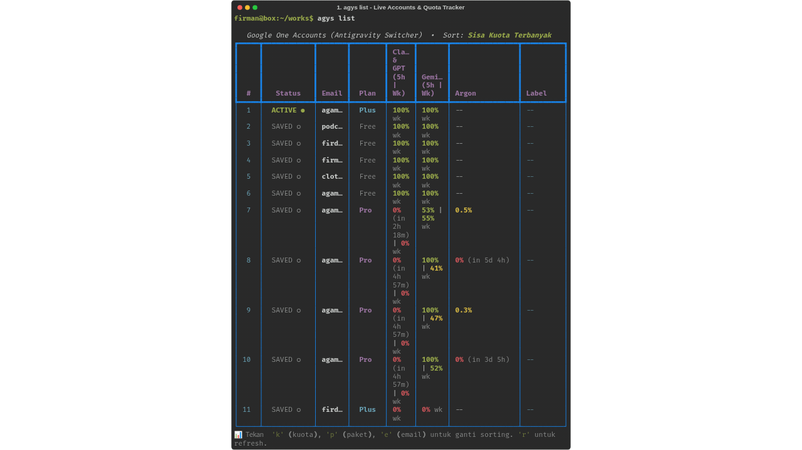
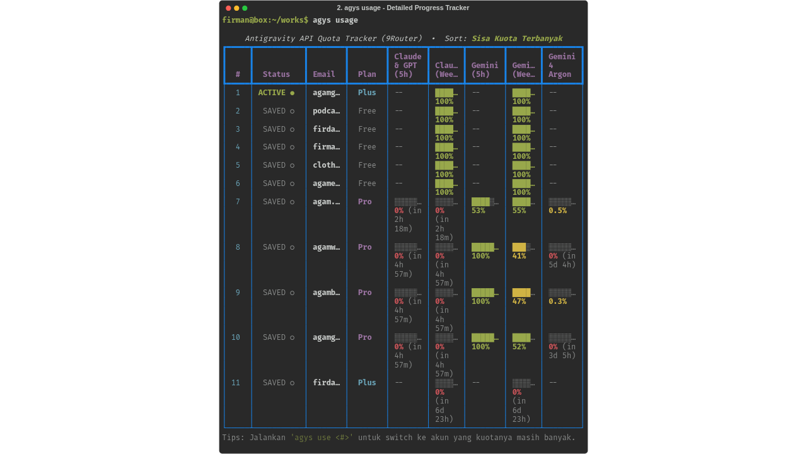
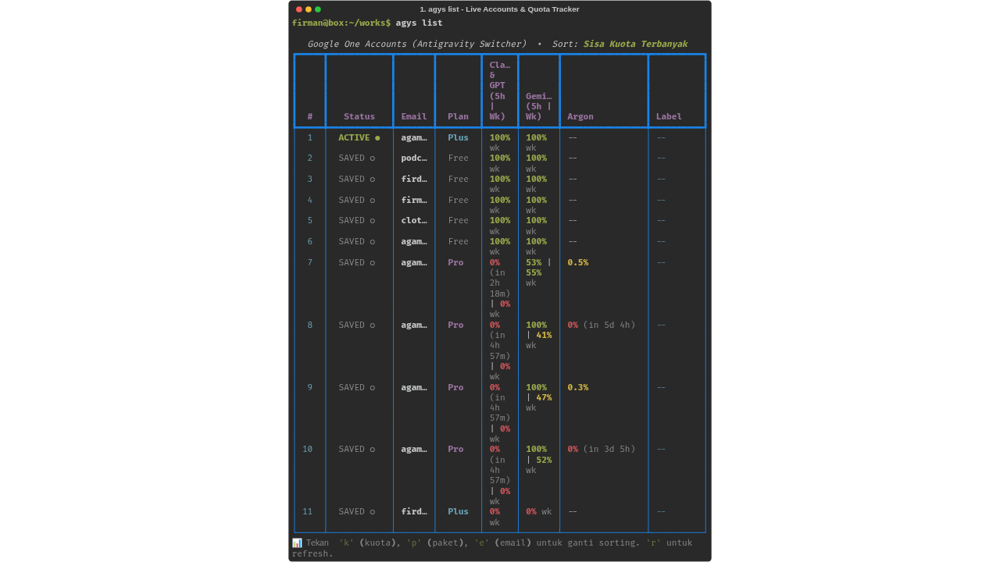
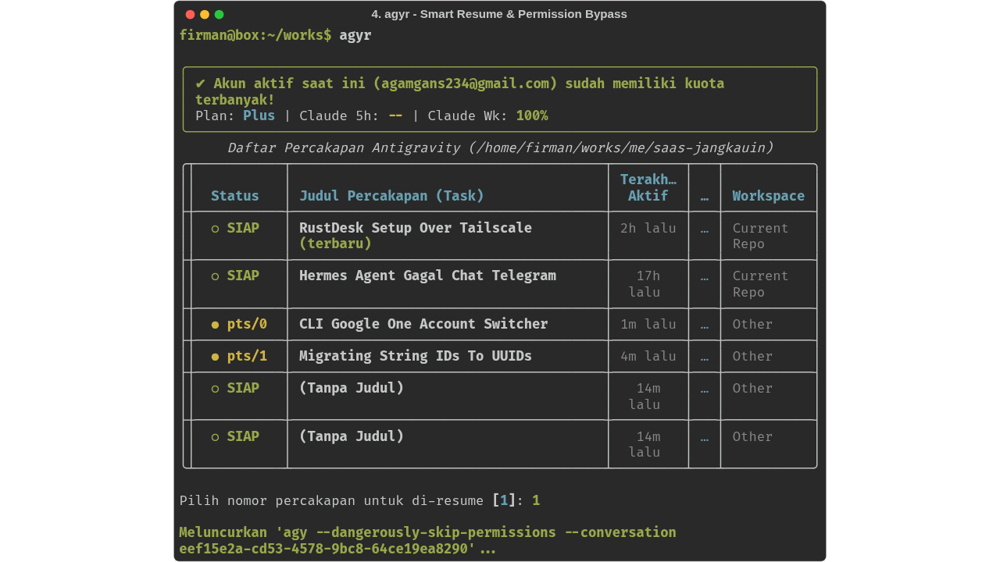

# Antigravity Switcher (`agys`)

[](LICENSE)
[](https://www.python.org/downloads/)
[]()

> **Fast, seamless multi-account switcher and real-time quota tracker for Google Antigravity CLI (`agy`).**

https://github.com/user-attachments/assets/9fcd95c3-383a-406c-840f-7ce93b29c228

---

## ⚡ The Problem

When working intensively with **Google Antigravity CLI (`agy`)**, developers frequently hit:
1. **5-Hour & Weekly Rate Limits:** Claude/GPT sessions or Gemini requests hit rate limits during heavy pair-programming sessions.
2. **Single-Account Constraint:** Antigravity CLI natively only supports **one active account** in the system keyring. Switching accounts officially requires deleting credentials and re-authenticating through the browser every single time.
3. **Multi-Terminal Collisions:** When running 4–6 terminals simultaneously across different features, running `agy -c` blindly resumes whichever conversation had the most recent disk activity, often causing terminal windows to collide and load the wrong chat context.
4. **Hidden Quotas:** To know which account has remaining quota, users had to manually open 9Router dashboards or inspect raw JSON.

---

## ✨ Features

- **⚡ Instant 1-Second Account Switching:** Swap active credentials in the OS keyring (`gemini/antigravity`) instantaneously without logging out or re-authenticating in the browser.
- **📊 Real-Time 9Router Quota Tracker:** Live tracking of 5-hour and weekly quotas for:
  - **Claude & GPT** (5-Hour Session & Weekly)
  - **Gemini** (5-Hour Session & Weekly)
  - **Gemini 4 Argon** (High / Medium / Low Shared Pool)
  - Cooldown countdown timers (e.g. `0% (in 2h 30m)`).
- **🏷️ Automatic Plan Tier Detection:** Automatically parses Google One subscription tiers directly from API responses (`Pro`, `Plus`, `Free`, `Ultra`).
- **🎯 Smart Quota-First Sorting:** Automatically ranks accounts with remaining 5-hour quota first, falls back to Plus/Free accounts with 100% weekly limit, and sorts exhausted accounts by soonest reset time.
- **🤖 Auto-Best Account (`agys auto`):** In 1 command, automatically detects and switches to the account with the highest available quota.
- **🔁 One-Command Auto-Resume (`agyr`):** When hitting a limit, simply `/exit` and run `agyr` to switch to the highest-quota account and seamlessly resume your current conversation!
- **🛡️ Multi-Terminal Collision Prevention:** Detects active PTY sessions (`● pts/2`, `● pts/0`) across running terminals to ensure you never accidentally overwrite or resume another terminal's active conversation.
- **🔓 Auto Bypass Permissions:** Configured to automatically pass `--dangerously-skip-permissions` across all commands and shell aliases.
- **🖥️ Beautiful Interactive TUI & Desktop GUI:** Terminal menu with Rich formatting, progress bars, and Zenity GTK desktop dialog support.

---

## 📸 Screenshots & Previews

### 🎬 Interactive Workflow Demo
Auto-looping walkthrough of `agys list`, `agys usage`, `agys auto`, and collision-free `agyr` resume.

<p align="center">
  
</p>

### 1. Detailed Live Quota Tracker (`agys usage` / `agys quota`)
Track 5-hour cooldown timers, weekly quotas for Claude 3.5 Sonnet & GPT, Gemini Pro, and Gemini 4 Argon progress bars.



### 2. Multi-Account Management & Sorting (`agys list`)
Compare all configured Google accounts sorted by remaining quota or plan tier (`Pro`, `Plus`, `Free`).



### 3. Smart Multi-Terminal Conversation Resume (`agyr` / `agys resume`)
Automatically switches to the account with the most quota and resumes your active task while avoiding terminal collisions.



---

## 📦 Installation

### Quick Install (One-Liner)

Clone the repository and run the install script:

```bash
git clone https://github.com/agambondan/antigravity-switcher.git
cd antigravity-switcher
./install.sh
```

The installer will:
1. Symlink `agys`, `agy-switch`, and `antigravity-switch` to `~/.local/bin/`.
2. Check and install Python dependencies (`rich`, `keyring`).
3. Add handy aliases to your `~/.zshrc` and `~/.bashrc`:
   - `alias agy="agy --dangerously-skip-permissions"`
   - `alias agyr="agys auto -c"`

Restart your shell or run `source ~/.zshrc` (or `source ~/.bashrc`).

---

## 🚀 Quick Start Guide

### 1. View Accounts & Live Quotas

```bash
# View list of saved accounts with live quotas and plan badges
agys list

# Detailed visual dashboard with progress bars
agys usage
# or
agys quota
```

### 2. Switch Accounts

```bash
# Switch by 1-based index from the sorted table
agys use 2

# Switch by email directly
agys use work-account@gmail.com

# Auto-switch to whichever account currently has the most quota
agys auto
```

### 3. Recovering From Rate Limits (The 2-Step Magic)

When a terminal hits a 5-hour or weekly quota limit:

```text
1. Inside agy: type /exit (or press Ctrl+D)
2. In the terminal: type agyr and hit [ENTER]
```

`agyr` will:
1. Scan all accounts and switch to the one with the highest quota.
2. Filter out conversations active on other terminals.
3. Automatically resume your exact conversation in that terminal!

---

## ⌨️ Command Reference

| Command | Description |
|---|---|
| `agys` | Open full interactive TUI menu |
| `agys auto [-c]` | Automatically switch to account with highest quota (`-c` to resume) |
| `agyr` | Shortcut alias for `agys auto -c` (auto-switch & resume) |
| `agys list [-s <mode>] [-r]` | Table view of accounts (modes: `quota`, `plan`, `email`) |
| `agys usage` / `agys quota` | Detailed progress bar tracker (Claude, Gemini, Argon) |
| `agys sort <mode>` | Change default sorting preference (`quota` \| `plan` \| `email`) |
| `agys use <acc> [-c]` | Switch account immediately (accepts index, email, or `auto`) |
| `agys resume [id]` / `agys c` | Interactive conversation picker to resume session in `agy` |
| `agys statusline [--tmux\|--plain]` | Sub-millisecond quota string for Tmux, Zsh RPROMPT, or polybar |
| `agys daemon <start\|stop\|status>` | Background watcher that sends desktop notifications when quotas reset |
| `agys watch [--interval 60]` | Run quota reset monitor in foreground |
| `agys add` | Login and add a new Google account via OAuth |
| `agys current` / `agys whoami` | Show currently active account in system keyring |
| `agys sync` | Sync active keyring token into switcher storage |
| `agys label <acc> <label>` | Update custom label for an account |
| `agys remove <acc>` | Remove an account from switcher vault |
| `agys test` | Test current credentials with `agy models` |
| `agys gui` | Open native desktop GTK dialog (Zenity) |

---

## 🔔 Background Watcher & Desktop Notifications

Never wonder when your Google One Pro cooldown has ended. The built-in daemon monitors quota states in the background and sends a native Linux desktop notification (`notify-send`) the moment your 5-hour quota has reset:

```bash
# Start watcher in the background (detached)
agys daemon start

# Check running status
agys daemon status

# Stop background watcher
agys daemon stop

# Or run live in foreground terminal
agys watch
```

When an account finishes cooldown, you'll receive a desktop notification:
> **⚡ Kuota Google One Reset!**  
> *Akun agam.pro234@gmail.com (Pro) kuota Claude & GPT-nya sudah reset dan siap digunakan kembali!*

---

## 📟 Tmux & Shell Statusline Integration

`agys statusline` executes in **< 1ms** by reading cached quotas, making it ideal for shell prompts and Tmux statusbars without introducing lag:

```bash
# ANSI colored (for Zsh / Bash prompts)
agys statusline

# Plain text
agys statusline --plain
# => [agamgans234|Plus] ⚡C:100% ♊G:100%

# Tmux formatted colors
agys statusline --tmux
```

### 1. Add to Tmux Statusbar (`~/.tmux.conf`)
```tmux
# Refresh statusline every 15 seconds
set -g status-interval 15
set -g status-right-length 120
set -g status-right "#(agys statusline --tmux) | %H:%M "
```

### 2. Add to Zsh Right Prompt (`~/.zshrc`)
```zsh
# Show active account & remaining quota on the right side of prompt
RPROMPT='$(agys statusline)'
```

---

## 🎛️ Interactive TUI Hotkeys

Launch `agys` without arguments to enter the interactive menu:

- **`[1..N]`**: Switch immediately to account number
- **`[b]`**: Auto-switch to account with highest quota (Auto-Best)
- **`[c]`**: Smart Switch & Resume conversation
- **`[v]`**: Conversation Picker (browse recent sessions & resume)
- **`[k]`**: Sort by Highest Remaining Quota
- **`[p]`**: Sort by Subscription Plan (`Ultra` > `Pro` > `Plus` > `Free`)
- **`[e]`**: Sort Alphabetically by Email (`A-Z`)
- **`[r]`**: Force refresh real-time quotas from 9Router
- **`[u]`**: Open Quota Tracker dashboard
- **`[l]`**: Rename / update account label
- **`[a]`**: Add new Google account
- **`[t]`**: Test current account credentials
- **`[q]`**: Quit

---

## 🔒 Security & Architecture

- **Zero Plaintext Credentials:** Tokens are securely stored in the OS Keyring (via SecretService / DBus on Linux, Keychain on macOS).
- **Per-Account Vault:** Non-sensitive account metadata and refresh tokens are isolated in `~/.config/antigravity-switcher/accounts/` with strict `0700` POSIX directory permissions.
- **Local SQLite Integration:** Reads locally from `~/.9router/` and `~/.gemini/antigravity-cli/` using read-only connections with 5.0s busy timeouts.

---

## 📄 License

MIT License © 2026 Agam Bondan. See [LICENSE](LICENSE) for details.
